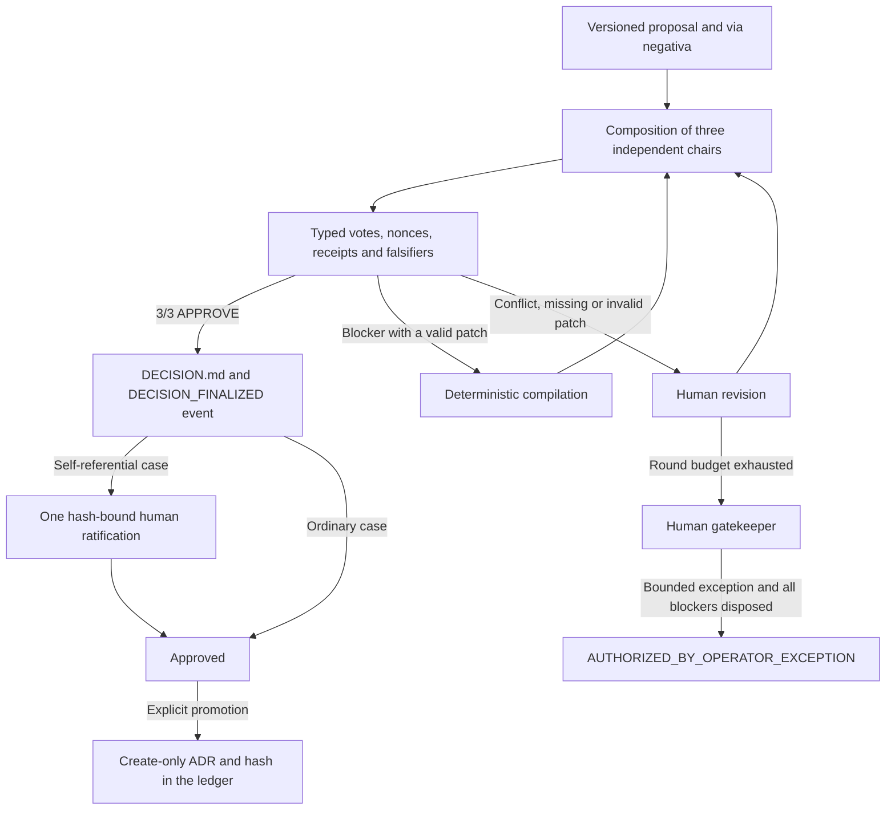

# Governance and Round Table lifecycle

This guide describes the Round Table contract in force. [ADR-056](adr/ADR-056_ROUND_TABLE_HUMAN_SOVEREIGN_GOVERNANCE.md) is the successor amendment and the current discovery point; it preserves and extends [ADR-053](adr/ADR-053_ROUND_TABLE_OPENROUTER_FALLBACK_GOVERNANCE.md), [ADR-054](adr/ADR-054_ROUND_TABLE_ROSTER_AND_GLM_5_3_GOVERNANCE.md) and [ADR-055](adr/ADR-055_ROUND_TABLE_DECISION_INTEGRITY.md) without rewriting their historical files.

## Authority model

The human gatekeeper is sovereign. In plain words, this is an explicit operational dictatorship, not a democracy of models: the Round Table acts as an independent consultative red team that finds real problems and suggests the smallest possible correction, but it has no political veto over an explicit human direction.

This does not authorize fictitious consensus. Votes and dissent stay immutable; when authority comes from the human after a review without consensus, the status is `AUTHORIZED_BY_OPERATOR_EXCEPTION`, never `APPROVED`. Scope, accepted risk, exclusions and the disposition of blockers remain mandatory. The definition was consolidated, approved unanimously and ratified in ADR-056.

## 1. Decision flow



Exactly three logical chairs take part in a round and each chair produces at most one vote. Independence is defined by `bias_domain`, which represents model lineage; API, CLI, provider, endpoint and effort do not create a new opinion. Fallbacks replace a chair 1:1.

If the engine cannot form three independent chairs, the case stays `HELD_UNAVAILABLE`. No mediator, scribe or operator can fabricate the missing vote. The quorum in force is `3/3` unanimity.

Human intervention does not change the quorum. Once the configured budget of up to three rounds is exhausted, the gatekeeper can close the case through a bounded operational exception. The status is `AUTHORIZED_BY_OPERATOR_EXCEPTION`, never `APPROVED`: the original vote stays preserved and the exception does not constitute consensus.

## 2. Mediation and scribe

The default mediation is a deterministic compiler of structured patches. A single valid blocker, with no conflicts and no human-revision marker, can generate and seal the next version without additional inference. Multiple, conflicting or patchless blockers go to `AWAITING_HUMAN_REVISION`.

LLM mediation is opt-in. The candidate must have a `bias_domain` different from every deployment that actually voted. If no independent candidate is available, the revision stays held; operational availability never relaxes cross-validation.

The default scribe is also deterministic and only projects facts that are already authoritative. It does not change the proposal, votes, tally, hashes or verdict. An LLM scribe is opt-in and remains non-authoritative.

## 3. Integrity and seal

New cases use `workflow_contract.schema_version=2`. The chained ledger records creation, versions, votes, tally and terminality. `DECISION_FINALIZED` binds `proposal_sha256` and `decision_sha256` separately; `verify` recomputes the file and requires a single compatible terminal event.

Votes are bound to seat, nonce, deployment, logical model, `bias_domain`, runner, real attestation status and streaming artifact. When a transport does not prove the served identity, the receipt records `unattested` or `request_pinned_unverified`; this is not described as full attestation. A proven mismatch fails closed.

Hashes make changes detectable within the observed history. They do not stop an unrestricted writer from destroying and rebuilding every file and the Git history; branch protection, human review and backups handle that threat.

## 4. Ratification and promotion

An ordinary Round Table answer does not require human ratification. Cases that modify governance itself stop at `APPROVED_PENDING_HUMAN_RATIFICATION` and receive a single explicit ratification, bound to the version, the proposal and `DECISION.md`.

An approved decision does not become an ADR automatically. The `promote-adr` command creates the target once, records the ADR hash in the ledger and is idempotent. Semantic authority remains with `DECISION.md`; the ADR provides discovery and traceability in the repository.

`adjudicate` is a different track from ratification. It only accepts a case in `AWAITING_HUMAN_REVISION` after the rounds are exhausted and requires:

- the exact version and SHA-256 of the current proposal;
- the authorized SHA-256 of an adjudication Markdown file;
- explicit sections for the ruling, blocker dispositions, scope, accepted risk and exclusions;
- mention and disposition of every blocker recorded in the last vote;
- the operator's declared identity and statement.

`self_referential=true` cases cannot use `adjudicate`: changes to governance itself require unanimous approval by the Round Table and an explicit human ratification. The guard runs before any state, ledger or artifact mutation.

The engine writes `OPERATOR_ADJUDICATION.md`, `DECISION.md`, the `OPERATOR_ADJUDICATED` and `DECISION_FINALIZED` events, and hash bindings between all of these artifacts. Operational exceptions are terminal and deliberately ineligible for `promote-adr`.

Example:

```powershell
py relay/round_table_engine.py ratify CASE-ID `
  --expected-version v001 `
  --expected-sha256 <proposal-sha256> `
  --operator-label owner `
  --statement "I ratify"

py relay/round_table_engine.py adjudicate CASE-ID `
  --file OPERATOR_ADJUDICATION.md `
  --expected-version v003 `
  --expected-sha256 <proposal-sha256> `
  --authorize-adjudication-sha256 <adjudication-sha256> `
  --operator-label owner `
  --statement "I authorize the bounded exception"

py relay/round_table_engine.py promote-adr CASE-ID `
  --adr-filename ADR-999_EXAMPLE.md `
  --title "ADR-999: Example" `
  --expected-version v001 `
  --expected-sha256 <proposal-sha256>
```

## 5. Storage and traceability

Operational state lives outside the repository, in `%LOCALAPPDATA%\tare.tools\round_tables` or in the local directory set by `TARE_ROUND_TABLES_DIR`:

```text
<runtime>/<CASE_ID>/
├── state.json
├── ledger.jsonl
├── proposals/
├── rounds/
├── streams/
└── decision/
    ├── DECISION.md
    ├── HUMAN_RATIFICATION.json   # only when required
    └── OPERATOR_ADJUDICATION.md  # only for an operational exception
```

Google Drive, OneDrive, Dropbox and similar services can receive replicas of finalized artifacts, but they are never the operational filesystem, a lock service or hot state. Git holds code, contracts and promoted ADRs; logs and streams stay in the local runtime or cold storage.

## 6. Verification commands

```powershell
py relay/round_table_roster.py --check
py relay/round_table_roster.py --roles    # deployments per agent role, separate table
py relay/round_table_engine.py verify CASE-ID
py -m pytest -q
```

The JSON roster is the single source of the matrix of chairs, fallbacks, mediators and scribes;
none of them uses Amazon Bedrock. Deployments for agent roles live in
`relay/role_deployments.json`, which only shares the `models` catalog with the roster. The Markdown projection is derived and must be regenerated, never maintained as a second manual source.
