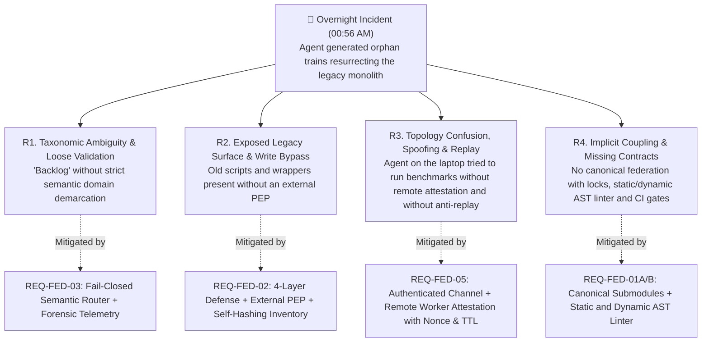
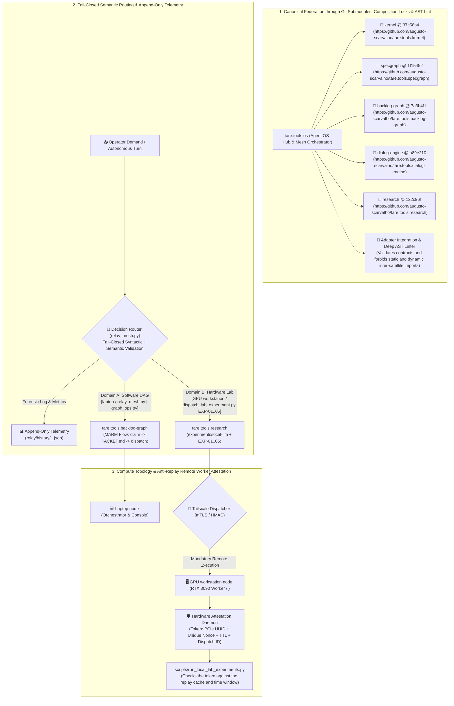

# ADR-049: Repository Federation through Git Submodules, Agent Anti-Drift Governance, Strict Backlog Separation and Cryptographic Node Attestation

- **Status:** Ratified and Approved by Full Tripartite Consensus (Google, Anthropic and OpenAI — Final Version v004)
- **Reference:** `CASE-2026-08-19-REPO-FEDERATION-AND-ANTI-DRIFT-GOVERNANCE-V4`
- **Date:** 2026-08-19
- **Superseded in part:** the node service is not a satellite; it lives in tare.tools.os as `node/` ([ADR-071](ADR-071_NODE_SERVICE_IN_THE_OS.md)).
- **Authors:** Antigravity Mediator under tripartite deliberation (OpenAI Codex, Google Gemini 3.7, Anthropic Claude Fable 5) and Human Engineering direction
- **Scope:** `tare.tools.os`, `tare.tools.kernel`, `tare.tools.specgraph`, `tare.tools.backlog-graph`, `tare.tools.dialog-engine`, `tare.tools.research`

---

## 1. Historical Context & Forensic Post-Mortem of the Overnight Incident

In the early hours of 19 August 2026 (~00:56 AM), the operator instructed an autonomous AI agent instance to *"continue the experiment backlog on the GPU workstation overnight"*.

Instead of dispatching and running the RTX 3090 inference and hardware experiments, the agent ran legacy automatic planning routines (`run_planner_auto.py`), combed through historical records of an outdated graph and generated 4 orphan *trains* (`TRAIN-37` to `TRAIN-40`) that referenced 186 modules of the discontinued monolithic prototype (`tare.tools.harness`).

### 🔬 Fourfold Root-Cause Analysis (RCA) & Governance Bijection



1. **`R1` — Taxonomic Ambiguity & Loose Validation:** The term "backlog" had a double meaning that was never formally demarcated: the OS code development graph vs. the pipeline of physical model and hardware experiments (`EXP-01..05`). The lack of strict pre-execution semantic validation allowed incompatible routing.
2. **`R2` — Unsafe Legacy Code Surface and Fragile Write Boundaries:** Utilities and wrappers from the monolithic era remained in the working tree; documentation-based policies in the same write domain as the agent allowed legacy entrypoints to be bypassed and recreated.
3. **`R3` — Physical Topology Misalignment, Spoofing and Replay Vulnerability:** The agent on the laptop console acted as if it were physically on the GPU workstation worker, trusting local environment variables that can be forged instead of authenticated dispatch over Tailscale with cryptographic attestation bound to a nonce and a validity window.
4. **`R4` — No Canonical Federation, Compatibility Locks or AST Purity:** Submodules were not checked against URL allowlists, were not validated by adapter integration tests in clean clones and had no static or dynamic barrier against cross coupling.

---

## 2. Proposed Architectural Decisions (In-Scope Goals)



---

### A. Canonical Federation through Git Submodules, Composition Locks and a Static & Dynamic AST Linter

1. **Consolidation of the Git Submodules Pattern & Canonical Allowlists:**
   - The central repository `tare.tools.os` manages the satellites through a canonical `.gitmodules` strictly restricted to authorized official URLs:
     - `tare.tools.kernel` $\to$ `https://github.com/augusto-scarvalho/tare.tools.kernel.git`
     - `tare.tools.specgraph` $\to$ `https://github.com/augusto-scarvalho/tare.tools.specgraph.git`
     - `tare.tools.backlog-graph` $\to$ `https://github.com/augusto-scarvalho/tare.tools.backlog-graph.git`
     - `tare.tools.dialog-engine` $\to$ `https://github.com/augusto-scarvalho/tare.tools.dialog-engine.git`
     - `tare.tools.research` $\to$ `https://github.com/augusto-scarvalho/tare.tools.research.git`
   - GitHub explicitly renders the link with `@ <commit-hash>`, allowing immediate visual audit of the exact state of the OS dependencies.
2. **Independent Life Cycle and Publication:**
   - Each satellite repository is an autonomous, pure and reusable library, with independent SemVer versioning, its own unit test suite and the ability to publish independently to PyPI / GitHub Releases.
3. **Consumption in the OS through Adapters:**
   - Any functionality specific to infrastructure, the local OS or cluster resilience lives in `tare.tools.os` (through adapters), without polluting the upstream libraries.

---

### B. Formal Separation of the Two Backlog Domains

| Dimension | Domain A: Software Engineering Backlog | Domain B: Hardware Experiment Backlog |
| :--- | :--- | :--- |
| **Scope** | Code development, AST refactoring, schemas, microkernel and release trains. | Measurement of TTFT, CUDA throughput, VRAM headroom, noise floor and promotion of local weights. |
| **Owning Repository** | `tare.tools.backlog-graph` (acyclic DAG `work-graph.json`) | `tare.tools.research` (`experiments/local-llm/`) |
| **Execution Command** | `python relay/relay_mesh.py` / `graph_ops.py` | `python scripts/run_local_lab_experiments.py` |
| **Governance** | Tripartite Quorum (Google/Anthropic/OpenAI) + MARM Relay | Scientific Cards `EXP-01` to `EXP-05` + `local-labs` |
| **Generated Artifacts** | Git diffs, audit reports and SemVer releases | JSON Benchmark reports, charts and qualification letters |

---

### C. Defense in Depth: *Deprecation Guards* in Legacy Scripts

1. **Blocking Execution of Discontinued Utilities:**
   - Every old script that orchestrated the discontinued monolithic prototype (`tare.tools.harness`) receives a *Deprecation Guard* that aborts execution immediately with error code 1 and a structured message:
     ```python
     raise RuntimeError(
         "DEPRECATED: The legacy monolithic orchestrator (tare.tools.harness) was discontinued "
         "by North Stars ADR-044 to ADR-048. Use the Backlog Graph and the Round Table."
     )
     ```
2. **Hardening of the Agent Directives (`AGENTS.md`):**
   - Maintain a mandatory *Anti-Drift Guard Rails* section that stops models in autonomous mode from resurrecting legacy entities during unattended turns.

---

## 2.1 Explicit Non-Goals (Via Negativa & Architectural Boundaries)

1. **No Return to the Monorepo / Monolith:** The coupled monolithic repository model of `tare.tools.harness` is **permanently extinct**. The ecosystem is strictly federated through Git Submodules.
2. **No Pollution of Upstream Repositories with Local Cluster Logic:** `tare.tools.backlog-graph` and `tare.tools.specgraph` remain pure agnostic libraries. No logic specific to Tailscale IPs, local hardware or OS scripts may be committed to their main repositories.
3. **No Unflagged Autonomous Execution of Legacy Scripts:** Autonomous agents are strictly forbidden from running scripts from historical directories without validating conformity with the active ADRs.
4. **No Relaxation of Zero Self-Auditing:** The repository split does not change the fundamental rule: whoever implements code (local or cloud) never approves their own code.

---

## 3. Falsification & Traceability Matrix

| Invariant / Requirement | Verification Mechanism | Automated Test / Falsifier | Implementation Module |
| :--- | :--- | :--- | :--- |
| **`REQ-FED-01`: Submodule Integrity** | `git submodule status` run at the root of `tare.tools.os` | `tests/test_submodule_integrity.py` | `.gitmodules` |
| **`REQ-FED-02`: Deprecation Guard Execution** | Direct invocation of a legacy monolithic train generator | `tests/test_deprecation_guards.py` | `scripts/` and `relay/` |
| **`REQ-FED-03`: Backlog Domain Isolation** | Execution test of the local experiment runner | `tests/test_backlog_domain_separation.py` | `scripts/run_local_lab_experiments.py` |
| **`REQ-FED-04`: Upstream Library Purity** | Static analysis in the `tare.tools.backlog-graph` CI | `tests/test_upstream_purity.py` | `src/graph_backlog/` |

---

## 4. Implementation Roadmap

1. **Phase 1 (North Star Synchronization & Remote Commits):** Commit and push the local North Stars in each of the satellite repositories (`kernel`, `dialog-engine`, `research`, `backlog-graph`).
2. **Phase 2 (Binding Canonical Submodules in `tare.tools.os`):** Configure `.gitmodules` pinning the canonical commits with `@ <commit-hash>`.
3. **Phase 3 (Deprecation Guards & CI Invariants):** Insert blocks in legacy scripts and create automated submodule purity tests.
