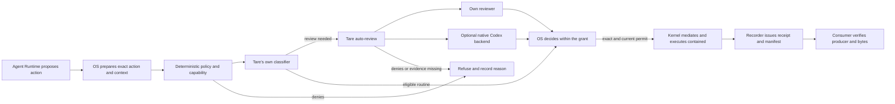

# TCP-04 — Classifier, auto-review, confinement and authenticity

- **State:** proposed architecture, reconciled on 2026-10-12; not activated in the runtime.
- **Existing Work:** `tcp04`; its three exit criteria remain intact.
- **Deliverable of this stage:** threat model, composition, integration contracts,
  initial profile and implementation packets. It is not evidence of a deployed sandbox.
- **Owners:** the OS decides policy and authority; the Kernel mediates effects and processes;
  the Agent Runtime keeps the loop, control and budget; the Backlog records the Work.
- **Structured projection:** [TCP04_ACTION_CONTROL_PROTOCOL.json](TCP04_ACTION_CONTROL_PROTOCOL.json).

## 1. Product decision

Build our own **auto mode classifier** and our own **auto-review**.
The classifier does fast triage; the auto-review examines the action and its authorization
when triage or policy demands additional analysis. Tare's auto-review
accepts interchangeable backends, including Codex's native reviewer. Codex is
the preferred candidate for that option because of its announced capability and zero price;
its integration path must be qualified before it is enabled.

Our own classifier stays useful when Codex is the reviewer: it cuts unnecessary
reviews and prepares the same action/context identity for both. Our own reviewer
allows operation without exclusive dependence on Codex. Both can also be
configured for a specific class of actions. Two favorable results
are not, by themselves, independent statistical evidence.

Deterministic policy, authority and confinement are distinct components.
A favorable model observation neither widens capabilities nor creates a permit.
The owner only authorizes the exact action within the authority the operator already granted.
Operations beyond that authority require an explicit, bounded grant.

This stage preserves the 2026-09-27 decision to postpone activating isolation.
The design prepares its implementation; it does not change settings, credentials,
models, TUI permissions or the executor of the current installation.

## 2. Observed state and reconciliation of the mechanisms

Focused reading of OS `5416dfae9c2e3f8ce5c8286c2939b38ec53dba05`, Kernel
`4645536ec0c0d3269f64f72b3fac00505701b353` and Agent Runtime
`d4c5ea9c9dfc29a2d0cbd8cc2ec684a692e520f3`. These are observed subjects,
not new pins to apply. The research program of 2026-10-07 contains earlier pins.

| Proposal / obligation | Current equivalent and source evidence | Gap | Owner / smallest intervention |
| --- | --- | --- | --- |
| Proposal identity and budget | `tare_tools_agent_runtime/native.py`: `EffectRequest`, `ModelPort`, `CapabilityPort`; `contracts.py`: execution control | Security snapshot of the action, context and policy | The OS prepares the request; the Runtime keeps control and budget |
| File mediation | Kernel `compute_plane/mediated_tools.py`: relative path, write scope, link refusal; `native_capabilities.py`: role and binding | Does not contain arbitrary commands nor establish a boundary against the same user | Extend the mediation point in the Kernel; do not create another tool runner |
| Commands and terminal | Kernel `compute_plane/terminal_host.py`: the grant selects root/env; `terminal_sessions.py`: containment and cleanup | CWD is not a sandbox; `start` and `send` produce effects | The Kernel mediates the action before spawn/input; the OS provides policy/authority |
| Our own fast classifier | Kernel `compute_plane/choice_assessment.py`: bounded observations, `authority: NONE` | The choices contract is not a calibrated security policy | Reuse worker/ModelPort where suitable; add an action projection and a specific assessment |
| Our own auto-review | Runtime `ModelPort` and Kernel `NativeModelAdapter` | Restricted role, context, typed output and action review policy | The OS orchestrates its own reviewer with the existing transport |
| Flow assessment | OS `relay/flow_assessment.py` | Choosing a flow does not authorize a command | Reuse observation/custody techniques; do not promote their verdicts to authorization |
| Revocation and late results | OS `relay/runtime_authority.py`: `CoordinatorAuthorityGate` | Check the same fence immediately before the effect, after review | Extend the existing checks; use FLOW-03/04 evidence |
| Artifact authenticity | Candidate/Work receipts bind hashes and identity; Kernel `control_plane`/`assurance_plane` do not provide the notary described in the historical guide | Keys outside the executor, producer identity and verification by the consumer | The Kernel implements the issuance/verification port; the OS chooses admitted producers |
| Confinement | The Kernel states explicitly that project roots are not a command sandbox | Effective backend and negative tests per platform | First, a disposable profile; no fallback to host execution when isolation is missing |
| Codex reviewer | The product documents Auto-review for eligible approval requests | No standalone classification RPC was identified in these sources | Public integration spike, keeping execution mediated and accounting for the delegated session |

`compute_plane/native_review.py` is edit snapshot/restore. It is not the new
action auto-review. The frozen harness modules and Aider do not enter
this composition. There is no need to create another repository, registry or runner.

## 3. Threat and trust model

**Assets:** files of the operator and of other projects; credentials and keys;
Work state; policy and grants; processes; receipts and artifacts;
budget and availability. Repository content, tool output and
model text are potentially hostile data, including for the reviewers.

**Intended TCB:** OS policy/authority, Kernel mediation/launcher and recorder,
authority storage, the operating system's isolation mechanism
and the receipt verifier. Classifier, reviewers, scripts and project content
are not authority. The broker is not exposed to the executor with a
capability to approve or widen its own scope.

| Threat | Required control | Evidence before enabling |
| --- | --- | --- |
| Malicious instruction in a README, skill, stdout or reviewer context | Context provenance; authority comes from the host; the decision does not follow the subject's instructions | The same action/context with hostile injection does not acquire capability |
| Swapping argv, script, stdin, env, cwd or target after review | Exact snapshot and a new pre-effect check | Changing any field invalidates the decision/permit |
| `../`, links, junctions, hardlinks or path races | Mediate paths and contain the process in the real filesystem | Writing outside the workspace/scratch fails; external sentinel intact |
| Seemingly routine script with an effect outside the project | Contextual classification plus a contained executor | The positive verifier runs; the escape attempt is observed and refused |
| Egress or access to local authority/credential endpoints | Network policy and isolation; specific access to required channels | External network and forbidden loopback do not cross the profile |
| Stale capability, policy, source or fence | Current identities/revisions before each effect | Resume/rebind does not reuse a stale approval |
| Late result, duplication after a crash or a command with an uncertain effect | Effect IDs, existing journal and reconciliation | No new effect while a result is pending/unknown |
| Reviewer unavailable, malformed, timed out or without enough context | Distinct states; budget and stop | A missing result turns into neither an approval nor a risk accusation |
| Switching reviewer or rephrasing a command to get around a denial | History of the denial in the episode; explicit routing policy | A denial does not trigger a fallback; a material alternative needs a new assessment |
| Forged artifact/receipt or self-attributed producer | Issuance outside the executor, admitted identity and consumer verification | Refusal of altered bytes, Work, producer, fence or profile |
| Later input into an interactive shell | Mediate `terminal_send` and the session state | The first profile excludes PTY/free shell; an approved `start` does not approve future input |
| Compromise of the same-user process or of the host | Isolated principal and key custody per profile | Declare the limit; hashes/token/locality do not prove privilege separation |

No resistance to a compromised administrator/kernel is promised. The first
profile also will not qualify arbitrary same-user processes outside the
sandbox as trusted producers. Reading a file can disclose a secret:
read-only is not a sufficient disclosure-risk classification.

## 4. Composition and boundaries

The diagram represents the proposed destination, not an active flow. In the case of
execution delegated to Codex, `Kernel` contains the whole adapter; an effect is
executed once by the responsible backend, never again by Tare after
receiving a favorable receipt.

There are two model tasks, with distinct contexts and budgets:

- **Own classifier:** classifies the proposal as eligible routine,
  review needed, denial recommended or insufficient evidence. It operates
  on a compact context with trusted facts and identified origin. Mechanical
  rules can refuse without inference; the classification does not override that refusal.
- **Own auto-review:** examines the action, the user's request, the grant, the effects,
  the triage findings and relevant context; it may suggest approval, refusal,
  clarification or issue no verdict. It may ask for limited read-only inspection
  by the host. It does not edit policy, does not execute the action, does not create grants.

No new model is chosen and no weights are downloaded in this stage. Existing
deployments can fill these roles after a packet with a ceiling and a profile.
Reusing a ModelPort does not automatically qualify the model as a guard.

## 5. Proposed contracts

The names below are candidate ports, not implemented APIs or ratified specs.
The associated JSON records operations, fields and qualification cases.

| Contract | Issuer / consumer | Minimum content |
| --- | --- | --- |
| `ActionSnapshot` | OS → policy, classifier, reviewer and Kernel | Work/session/effect/binding/fence; operation; exact argv or script; cwd/repo; stdin/payload; env by identity/redaction; paths/targets; source/policy/grant snapshots; profile; deadline |
| `AssessmentRequest` | OS → `ActionClassifierPort` or `ActionReviewerPort` | Action snapshot; required visible public context and its provenance; relevant denial history; budget/deadline; inspection permissions; disclosure policy |
| `AssessmentObservation` | Adapter → OS | Stage/backend and version; request/action/context/policy digests; status/verdict/reason; observed or unknown usage/cost; latency; origin of the result; `authority: NONE` |
| `ActionAuthorization` | Authority owner → Kernel | Exact digest of the action and decision; identity/fence; single effect; scope; qualified profile; expiry; link to the grant; host-issued integrity/authenticity |
| `EffectReceipt` / manifest | Kernel recorder → consumer | Action/Work/producer and environment identity; effective limits; start/result/cleanup; hashes of outputs and artifacts; issuer signature/identity when implemented |
| `ReviewedExecutionPort` | OS → contained delegated backend | Recorded action and maximum external permit; the backend keeps native review; returns the observation and receipt of the effect actually executed |

Do not normalize shell into argv by heuristic and lose operators/quoting.
When there is a shell/script, the snapshot includes the exact bytes, interpreter and
relevant executable/imported artifacts. Paths are resolved by the host.
The model's request never selects env, key store or grant.

Decisions/caches are bound to action + context + policy + grant + source +
profile + fence. An assessment cache may keep an observation under material
equivalence; it is not an authorization cache. The permit is consumed by the single effect.
An inspection that discovers new facts creates a new revision of the request.

## 6. Decision, combination and failure semantics

1. Validate identity, grant, deadline, budget, source and profile. A deterministic
   refusal ends the action before any model call.
2. Fast triage only waives review where policy admits that waiver.
   A routine classification does not waive a mandatory review or human approval.
3. Select the reviewer through host configuration. Candidate modes: `tare`,
   `codex_native` and `both_required`. In the third, both required observations
   must approve the same subject; disagreement is not resolved by majority.
4. The result of each stage is `OBSERVED`, `ABSTAINED`, `UNAVAILABLE`, `TIMEOUT`,
   `MALFORMED` or `CANCELLED`. A verdict only exists in `OBSERVED` and is separate from the status.
5. A denial triggers neither another reviewer nor indirect execution. A fallback for
   unavailability only exists if preconfigured, uses the remaining budget and does not
   fabricate an approval from the missing backend. `both_required` does not downgrade.
6. The owner revalidates context, capability, cancellation/fence and state immediately
   before the effect. A valid approval from yesterday does not make the capability current.
7. Persist intent/result in the existing journal. If there was an effect without a sufficient
   receipt, reconcile; do not execute again to try to obtain evidence.

The repetition circuit counts reasons, attempts and denials per episode.
Its limit belongs to the chosen policy, with an explicit ceiling in the packet. Review
does not reset the Work's budget/deadline. After a denial, only a materially
safer alternative or a new explicit grant can produce a new action.

The reviewer itself may produce malicious output. Its reason is advisory text;
an action suggested in it does not become a tool call. Reviewer inspections go through the
same read-only ports and disclosure limits, without access to credentials.

## 7. Codex as optional preferred backend

The [Auto-review documentation](https://learn.chatgpt.com/docs/sandboxing/auto-review)
confirms review of eligible requests inside Codex, configured with
`approvals_reviewer = "auto_review"` and an interactive policy. It does not
automatically review every permitted action. The
[documentation for custom runtimes](https://developers.openai.com/api/docs/guides/agents/guardrails-approvals)
explains that the Responses API and the Agents SDK do not inherit this feature.

The free-of-charge announcement pointed out by the operator is a reason to prioritize the
native adapter. It does not turn an ordinary model call into a free
auto-review, nor does it make the delegated main session free. Record separately
the usage/cost of the reviewer, of the delegated session and of the control. Missing information is
unknown. Being free does not replace qualification of the integration.

**Local public inspection, without inference:** the schema generator of `codex-cli
0.162.1` exposes `item/autoApprovalReview/started`,
`item/autoApprovalReview/completed` and `autoApprovalReview/strictReviewRequired`.
The completed event contains `reviewId`, `threadId`, `turnId`, `targetItemId`, action,
timestamps, origin and a review with states `approved`, `denied`, `timedOut` or
`aborted`. The payload is marked `UNSTABLE`; the adapter must check the version
and correlate event, tool arguments and recorded action. The inspection confirms
an observable surface, not the live behavior nor the billing.

In the observed protocol, `review/start` starts a code review and
`thread/approveGuardianDeniedAction` handles retrying a denied action. Neither of them
was identified as a standalone RPC of the native auto-review. Do not use code review
as a substitute labeled as free. The current Kernel adapter in
`compute_plane/native_cli.py`/`native_cli_codex.py` is stateless inference with no
tool execution by the vendor; the native integration needs a
distinct adapter, without enabling effects in the existing ModelPort.

The spike starts with the public surfaces:

| Path | Claim allowed now | Required qualification |
| --- | --- | --- |
| Mediated tool/MCP request under native review | Integration candidate; the product documents review of eligible MCP | Effective version/config; review actually triggered; exact payload; a negative decision prevents the effect; the bridge only accepts the current capability |
| Execution delegated to a contained Codex session | Integration candidate using the [App Server](https://learn.chatgpt.com/docs/app-server) and documented approvals | External sandbox; bound native observation; authenticated return; session accounting; single effect; cancel/recovery |
| Standalone reviewer RPC | **Not established by this research** | A public interface that returns a bound verdict before the effect; do not infer that result from an exit code or silence |
| Review prompt for a model through ModelPort | Own reviewer implemented with a compatible model | It is a different implementation; measure tokens/cost and do not label it as a free native reviewer |

Do not extract internal protocols, copy cookies/credentials or change the operator's global
configuration. The adapter uses an isolated, authorized configuration. An approval
in Codex only holds for its subject/context; Tare's broker does not widen the grant.
The absence of a prompt, a completed tool or text saying "safe" does not prove review.

The Claude reference is product inspiration and a source of assessment contrasts;
consuming Claude's native classifier is not a requirement. The
[permission modes documentation](https://code.claude.com/docs/en/permission-modes)
and the [Agent SDK documentation](https://code.claude.com/docs/en/agent-sdk/permissions) distinguish
classification, rules, hooks and execution. Our interface does not depend on a
private classifier endpoint nor reproduce third-party runtimes.

## 8. Minimal confinement and authenticity profile

**First subject:** a disposable-workspace command/verifier by argv;
no secrets, publishing, administrative commands, installation, egress or free
PTY. Capture only selected files; do not clone HOME or credentials.
The process uses a disposable workspace and scratch, separate from the operator's repo/WIP.
The result comes back as a verified candidate artifact, not as a direct write
into other projects. Child env and mounts include no keys, stores or approval channel.

| Platform | Minimal candidate | Claim limit |
| --- | --- | --- |
| Linux | Namespace/mount/network policy with [Bubblewrap](https://github.com/containers/bubblewrap), if available and qualified | Bwrap is a mechanism; its arguments and mounts must satisfy the profile |
| Windows | [AppContainer](https://learn.microsoft.com/en-us/windows/win32/secauthz/appcontainer-isolation) backend with ACL/capabilities; or an explicitly identified isolated Linux implementation | Python/Git, filesystem, network and IPC compatibility needs proof; WSL is not a native Windows sandbox |
| Host without a qualified backend | Inspection/planning; the restricted profile does not execute | No silent fallback to the current host terminal |

This table selects small hypotheses; it does not install infrastructure. WSL with Windows
drives, interop, sockets or shared stores needs those channels
explicitly confined; starting a distro is not proof.

**Authenticity:** every artifact exported by the profile has a byte manifest
and a receipt bound to action/Work/fence/producer/profile. The host recorder
issues the identity; the assessed process does not choose the producer name, does not
receive the key and does not sign its own result. The consumer validates an admitted
issuer, the signature when implemented, the manifest, replay and the expected subject.
A hash proves byte correspondence, not producer identity nor correctness.
Key custody must sit outside the executor's write/read domain.

This port will be implemented in the Kernel and admitted by the OS. The notary/Ed25519 of the
old guide is an architecture target, not a mechanism observed in the current path.
Do not unlock TCP-05 trusted CI with only self-attributed or unsigned artifacts
when the profile requires producer authenticity.

## 9. Sequential implementation and fail fast

The numbers are packets proposed by this plan, not newly admitted Work IDs.

| Packet | Owner | Bounded delivery | Closing evidence |
| --- | --- | --- | --- |
| 0 — this stage | OS + reading of the satellites | Reconciliation, threat, interfaces, combination policy and profile | Consistent references/JSON; no activation; `tcp04` progress recorded with true residuals |
| 1 — exact mediation | OS + Kernel | Own snapshot/ports and pre-effect binding over already mediated execution; fake classifier/reviewer | 12–16 finite falsifiers: identity, bytes/env/stdin, stale source/policy/fence, deny/fallback, unknown/crash; zero external inference |
| 2 — confinement and producer | Kernel, consumed by the OS | One backend and recorder/verifier for the first profile, then separate qualification of the second platform | Positive and negative write/network/IPC/key controls; tampered artifacts refused; real cleanup and recovery |
| 3 — own classifier and auto-review | OS + existing Runtime/Kernel | ModelPort/worker in its own role, initially shadow on a disposable profile | Budget fixed in advance; cases per family and context; separate policy/reference/effect; do not mistake a fixture for calibration |
| 4 — native Codex | OS adapter + Kernel confinement | Public spike; select a route that proves bound native review | Approve/refuse/no-verdict/timeout/cancel/replay of the same subject; accounting evidence; if the port is missing, declare it unavailable |
| 5 — canary and composition | OS + Kernel | Enable only the qualified profile and backends | Limited real use, stop at the first critical failure, preservation and rollback; expansion by class/platform |

Packets 1–2 do not depend on an AI vendor. The feasibility spike of
packet 4 can be brought forward as a contract inspection, without activation/model calls;
that way we avoid investing in an adapter without a usable public surface.
Real inference execution depends on the specific ceiling/profile, not on this document.

Stop at the first profile failure, preserve the original run, fix the
cause and repeat only the failed case. Then continue. Do not import the whole
backlog of the research program, open a training campaign or download models.
The existing Local Labs owns experiments/calibration; do not create a parallel
laboratory. Ordinary suites use synthetic fixtures, not operator data.

## 10. Closing the Work and metrics

| Original `tcp04` criterion | This stage | Evidence still needed |
| --- | --- | --- |
| Strict path confinement preventing writes outside designated scratch/workspace areas | Threat, profile and owner defined | Effective backend per platform/activated route, sentinels and negative controls |
| Producer authenticity verification for all generated artifacts | Issuance/verification, TCB and identity defined | Authenticated recorder, key custody and refusal of tampered artifacts/receipts |
| Unlocks TCP-05 trusted CI | Gate and dependencies defined | Both previous criteria demonstrated in the CI profile; do not unlock on architecture alone |

`tcp04` stays **PARTIAL / IN_PROGRESS** while that evidence is missing.
The architecture packet can be delivered without declaring isolation delivered.

Proposed metrics per profile and backend: eligible/classified/reviewed count;
human interventions; adjudicated false blocks; observed undue effects;
abstentions/failures; altered/stale requests refused; sentinel escapes;
duplications; p50/p95 latency; tokens/cost per stage and per Work; net gain
compared with the competent mechanical baseline. An external reference is not ground truth.
Do not multiply reviewer error rates as if they were independent.

## 11. Research basis and custody

Program `tare-tools-action-control-program-v0.1-2026-10-07`, ZIP SHA-256
`09a294bc8ca006791d32cb72ed21edf060fe839f0c64084a61784802659aafbb`;
18 internal checksums checked by our own reader. `FIRST_PACKET.md`,
`PROTOCOL.md`, `RESEARCH_REUSE.md`, `PROGRAM.md` and `SOURCE_BASIS.json` inform
this design. Their state is a proposal and their installation was not observed.
No scripts from the archive were run and none of its IDs/pins were promoted to canonical.
Transcripts and operational data remain in private custody; they do not go into the PR.

Primary technical sources were read on 2026-10-12 and are linked next to the
claims above. The article [pointed out by the operator](https://www.progressiverobot.com/2026/10/06/auto-review-free-chatgpt-codex-all-users/)
prompted the check of the Codex option; it does not serve as proof of a standalone API,
per-account availability or qualification of Tare's adapter.
